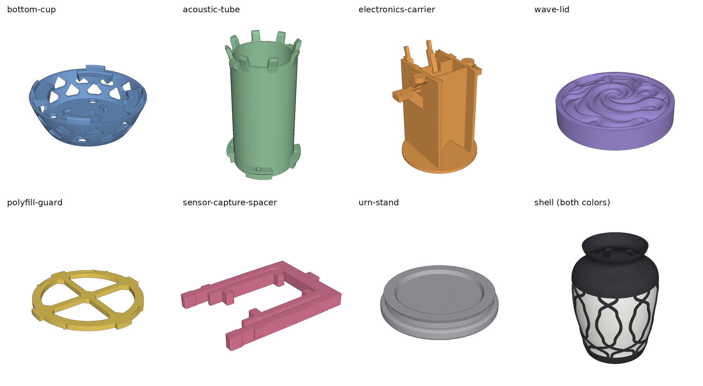
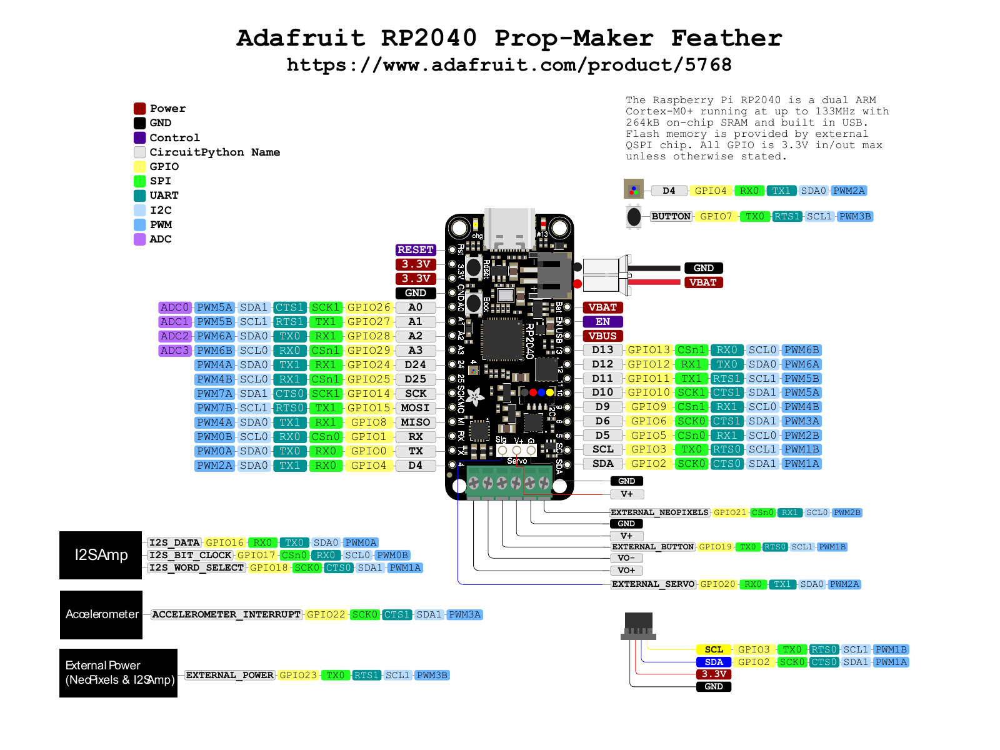
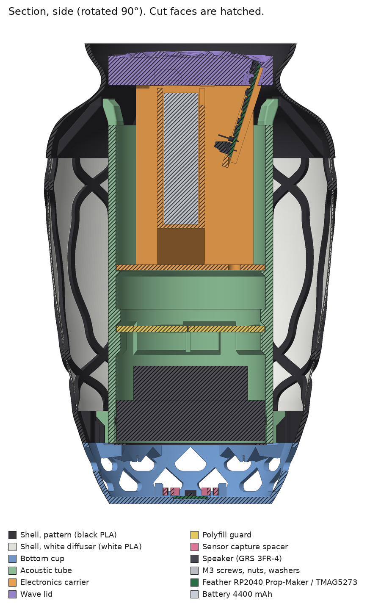
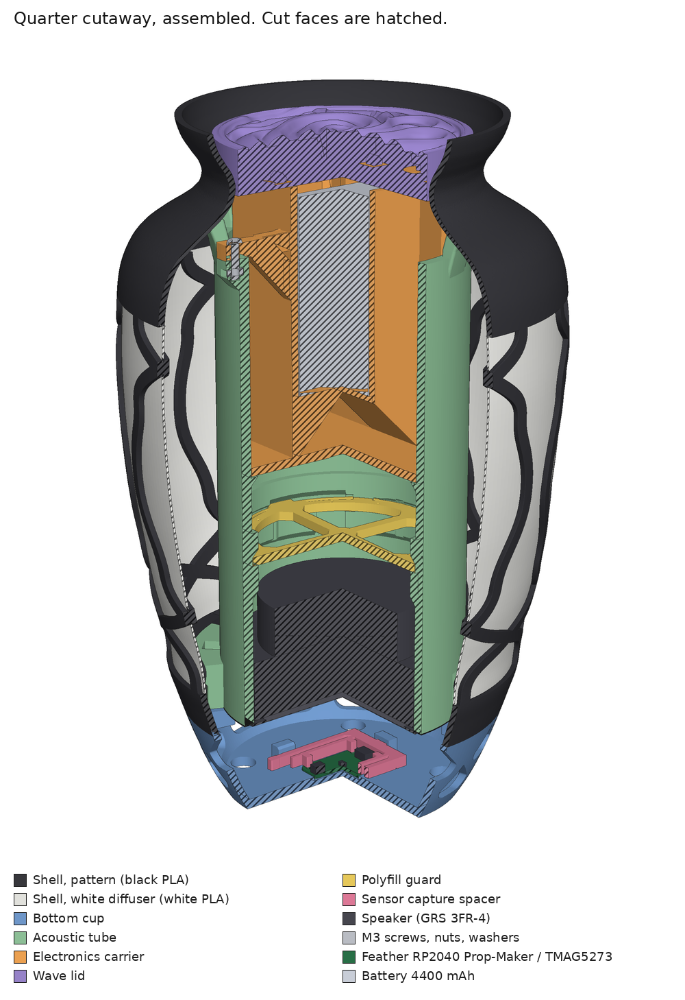
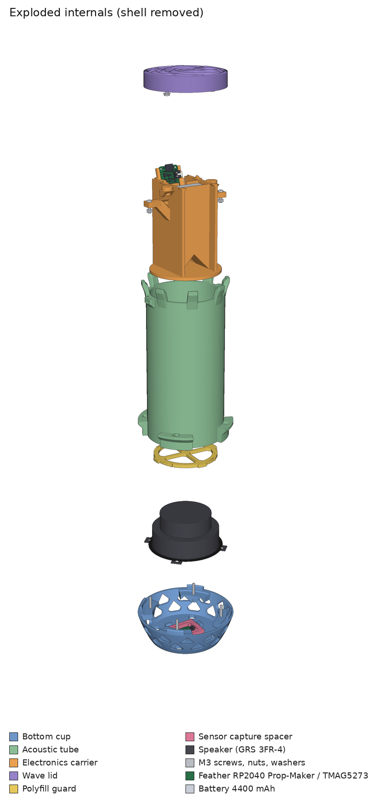
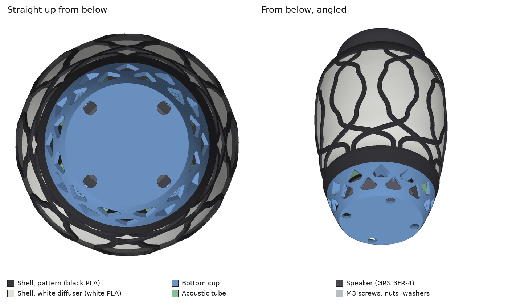

# Soul Urn

> Fan project. Not affiliated with or endorsed by Valve. Deadlock and the Soul
> Urn are trademarks of Valve Corporation. No game files are included.

<a href="https://youtube.com/shorts/FrbNpWx47Ck"></a>

[I built a real-life Soul Urn from Deadlock 🏺](https://youtube.com/shorts/FrbNpWx47Ck)

A physical, motion-reactive replica of the Soul Urn from Deadlock. It fills on
one of two stands, telling them apart by the magnet in each (one North-up, one
South-up). It knows when it's picked up, carried, set down or dropped, and
talks back with in-game voice lines while bells jingle like real ones. It
doesn't include the hero-specific urn lines (though they'd probably fit on the
board), or the urn expiring.

Built on an Adafruit RP2040 Prop-Maker Feather running CircuitPython, with a
TMAG5273 magnetometer for stand detection, the onboard LIS3DH accelerometer for
motion, a 120-pixel WS2812B strip and a 4 Ω speaker.

You'll have to extract the sounds from the game yourself (see [Set up the software](#3-set-up-the-software)).

Thanks to:

- **Valve.** The Soul Urn has tons of personality, and it's a great game
  mechanic with great sound and art design. Nice work on that.
- **Bambu Lab.** This printer is so excellent. Thanks for never letting me down
  and for building a high-quality product. Hats off to you.
- **Meshy.** Great service. It worked the first time.

Build one? Share your photos and videos! I'd love to see it.

## Setup

### 1. Buy the parts

Ensure you have everything in the [parts list](#parts-list), including the
tools and supplies under it.

### 2. Print

The prints take about 2 days to complete, so kick those off first.

Everything was printed with Bambu Studio's default settings, on a [**Bambu Lab X2D**](https://bambulab.com/en-us/x2d) (highly
recommended) for the dual-nozzle shell. Print everything in its natural
orientation: bottom down, top up. The files to print are in
`hardware/stl-export/`, exported from the Blender model in
`hardware/mesh/soul-urn.blend`.
These large files are stored with Git LFS, so install it before cloning
(`brew install git-lfs && git lfs install`), or download them from GitHub.

<a href="hardware/images/printed-parts.png"></a>

- **Shell:** drag both shell STLs in together and treat them as a single
  object. Set the pattern to black and the white diffuser to white, and set the
  white's infill to 100%. Seam alignment set to "Nearest" worked best to keep
  seams out of sight; it's not perfect, so use whatever works best for you.
- **Sensor capture spacer:** 100% infill. (It's a badly designed part.)
- **Urn stand (print two):** slice it, then add a pause at the layer just
  before the center gets filled in. When the print pauses, drop in the magnet
  and glue it down (e.g. Loctite super glue) so it doesn't snap to the metal
  print head.
  Let it sit a few minutes, then resume. Put one magnet North-up and the other
  South-up.
- When the parts come off the printer, rip out all the supports.
  Support-free printing is an aspiration for v2.

### 3. Set up the software

1. Install Python 3 and ffmpeg with [Homebrew](https://brew.sh):
   `brew install python ffmpeg`. If you've never used Homebrew, ask an AI
   assistant to walk you through it. The scripts assume macOS, where the board
   shows up as `/Volumes/CIRCUITPY`.
2. Set up the board:

   ```sh
   bash tools/setup_board.sh
   ```

   This downloads CircuitPython 10.2.1 and installs it, then copies the
   libraries the urn needs onto the board. When it asks, plug the board in over
   USB, hold its **BOOT** button and tap **RESET**.

   <a href="hardware/images/prop-maker-feather-pinout.png"></a>

   Pinout diagram © [Adafruit](https://learn.adafruit.com/adafruit-rp2040-prop-maker-feather/pinouts).
3. Get the game files. If Deadlock is installed through Steam on Windows, skip
   this and use that install. Deadlock has no Mac version, but you can download
   the Windows game on a Mac with DepotDownloader. Deadlock has to be on your
   Steam account.

   ```sh
   brew tap steamre/tools
   brew install depotdownloader
   DepotDownloader -app 1422450 -os windows -osarch 64 -qr -dir ~/Deadlock
   ```

   It shows a QR code in the terminal; scan it with the Steam mobile app and
   approve the login. The download is about 39 GB. You can also get
   DepotDownloader from its
   [releases page](https://github.com/SteamRE/DepotDownloader/releases)
   instead of Homebrew (the `macos-arm64` zip, or `macos-x64` on an Intel Mac);
   then run `./DepotDownloader` from the unzipped folder, and if macOS refuses
   to run it, run `xattr -d com.apple.quarantine DepotDownloader` first.
4. Extract the sounds from your own Deadlock install (they aren't shipped with
   this repo):

   ```sh
   python3 tools/extract_game_audio.py ~/Deadlock   # or your Steam install folder
   ```

   This reads the game's archives directly and saves the 75 voice lines, 17
   sound effects and the carry music to `audio/source/`, under their game file
   names.
5. Convert them for the urn:

   ```sh
   python3 tools/prepare_audio.py
   ```

   This writes `audio/processed/` (and the simulator's copy), all mono at
   22.05 kHz: voice lines and effects as 48 kbit/s MP3 with trailing silence
   trimmed, bell jingles and carry music as WAV (the board decodes only one MP3
   at a time, and these play over speech). It totals about 4.1 MB with the carry
   music, leaving about 3.1 MB free on the board's 7.3 MB drive.

6. Connect everything to the board with the USB unplugged. Plug in the LED
   strip and the speaker before the battery, then plug in the USB last. See the
   [pinout](hardware/images/prop-maker-feather-pinout.png) in step 2 for where
   each wire goes:

   - LED strip: `DIN` to `Neo`, `+5V` to the NeoPixel `5V`, `GND` to `G`.
   - Speaker: slide the spade terminals onto the speaker's tabs, and the bare
     wire ends into the `+` and `-` speaker terminals.
   - Magnetometer: the STEMMA QT cable into the STEMMA QT socket.
   - Battery: the JST-PH battery connector.
7. Flash the urn, with the board plugged in over USB:

   ```sh
   bash tools/flash_urn.sh               # with the carry music
   bash tools/flash_urn.sh --no-music    # without it
   ```

   It compiles the firmware (downloading Adafruit's `mpy-cross` once), backs up
   the board to `firmware/urn/device-backups/`, checks free space, copies the
   sounds (1–2 minutes; the board writes slowly), then copies the firmware last,
   and the urn restarts by itself. Run it again whenever you change
   `firmware/urn/code.py` or `firmware/urn/settings.py`.
8. Check that the LED strip lights. For a quick lights-only test,
   `bash tools/flash_rainbow.sh` shows rainbow bands moving up the strip;
   `bash tools/flash_urn.sh` puts the game back.
9. Check that you hear the urn through the speaker.
10. Hold a magnet next to the magnetometer; the urn should react as if it were
    set on a stand. The serial output (`screen /dev/tty.usbmodem* 115200`)
    prints the field (`z_uT=`).
11. Unplug the USB and check that the urn runs on the battery, then plug it back
    in and check that it charges.

### 4. Put it together

<table>
<tr>
<td><a href="hardware/images/section-side.png"></a></td>
<td><a href="hardware/images/cutaway.png"></a></td>
<td><a href="hardware/images/exploded.png"></a></td>
</tr>
</table>

Cut faces are hatched, and the printed parts are shown in distinct colors so
they're easy to tell apart. Click an image for full size.

| Connection | Screws | Nuts / washers |
| --- | --- | --- |
| Bottom cup | 4 × M3 × 20 mm | 4 M3 nuts + 4 washers |
| Carrier → acoustic tube | 2 × M3 × 12 mm | 2 M3 nuts; no washers |
| Wave top → carrier | 2 × M3 × 10 mm | 2 M3 nuts + 2 washers |

1. **Clear the screw and nut holes.** Everywhere a screw or nut will go, run a
   screw through first to make sure nothing's in the way. You don't want to
   fight this later.
2. **Wrap the LED strip around the acoustic tube.** Line the carrier up where it
   will screw onto the tube, start the strip where it will connect to the
   board, and wrap downward. Aim for even coverage over the tube, but don't
   obsess. Keep it taut once it's laid out, then peel off the backing and
   commit.
3. **Wire the speaker and the magnetometer.** Clip the spade terminals onto the
   speaker tabs, plug the STEMMA QT cable into the magnetometer, and seat the
   magnetometer in the sensor capture spacer in the bottom cup. Get the wires
   ready to run up through the tube.
4. **Fit the polyfill guard and fill the chamber.** Push the polyfill guard up
   into the tube from the bottom and twist it into place. Set a small piece of
   speaker mesh on top of it (fix it there if you prefer); the wires run up
   past one side. Add polyfill from the top, loosely, not packed. Drop the
   carrier in: it should go down without a fight. If it drops with no
   resistance at all, add a bit more; if you have to push to close it, that's
   too much.
5. **Connect the board.** Run the speaker and magnetometer wires up through the
   hole in the bottom of the carrier and connect them, and the LED strip, to
   the board (see the pinout in Setup step 3). Slide the board down into the carrier.
   Make sure you're not fighting the wires, and keep them organized.
6. **Fit the switch.** Snap the switch into the wave lid and attach the spade
   terminals. Plan where the wires will go first; I broke off the right side
   wall to make room for the wires coming down from above there (v2!). Cut the
   wires to length, strip them, and solder one to `GND` and the other to `EN`.
7. **Fit the battery.** Drop it into place and plug it into the board. The board
   powers up as soon as the battery is connected unless the switch is off.
8. **Load the lid nuts.** Put two M3 nuts into their holes in the lid; they drop
   behind the smaller hole, ready to take the screw.
9. **Fit the wave lid.** Carefully slide it into place. It sits flush against the
   carrier, and the USB port should sit flush with the lid surface. Run the two
   M3 × 10 mm screws, with washers, through the carrier into the nuts. This is a
   dance; take your time (v2!). The carrier and lid are now one connected block.
10. **Screw the carrier to the tube** with the two M3 × 12 mm screws and nuts.
11. **Load the tube nuts.** Put four M3 nuts into the nut pockets at the bottom
    of the acoustic tube; they sit flush when they're in position. From here
    you have to keep the tube upright, or put a tiny dot of superglue on each
    nut so assembly isn't so precarious.
12. **Fit the speaker** into the bottom of the tube, lined up with the holes.
13. **Slide the core into the shell.** Slide the whole assembly up into the
    shell, past the shell's shelves, then rotate it until it lines up with them
    exactly.
14. **Fit the bottom cup.** It only snaps into place when the core is rotated to
    match the shell.
15. **Screw it together.** Run the four M3 × 20 mm screws, with washers, up
    through the bottom cup and the speaker into the nuts in the tube.

<a href="hardware/images/bottom.png"></a>

You're done.

## Parts list

| Qty | Part | Link | Notes |
| --- | --- | --- | --- |
| 1 | Adafruit RP2040 Prop-Maker Feather | [Adafruit #5768](https://www.adafruit.com/product/5768) | Main board: audio amp, LED output, accelerometer |
| 1 | Adafruit TMAG5273 (A1) 3D Hall-effect magnetometer, STEMMA QT | [Adafruit #6489](https://www.adafruit.com/product/6489) | Stand sensor, in the cup |
| 1 | STEMMA QT / Qwiic cable, 400 mm | [Adafruit #5385](https://www.adafruit.com/product/5385) | Magnetometer to Feather |
| 1 | ALITOVE WS2812B strip, 5 mm wide, 2 m, 60 LEDs/m (120 LEDs) | [Amazon](https://www.amazon.com/WS2812B-ALITOVE-Addressable-Programmable-Raspberry/dp/B07RBVKLPX) | 5 V RGB, GRB order. Self-adhesive backing: peel and stick it around the tube |
| 1 | GRS 3FR-4 Full Range 3" Speaker Driver, 4 Ω | [Amazon](https://www.amazon.com/dp/B00K2ESJZ2) |  |
| 1 | Lithium-ion battery pack, 3.7 V 4400 mAh | [Adafruit #354](https://www.adafruit.com/product/354) | Two 18650 cells, about 69 × 37 × 18 mm, 95 g, JST-PH plug. The electronics carrier is sized for this pack |
| 1 | KCD11 mini rocker switch, SPST 2-pin, 10 × 15 mm (10-pack) | [Amazon](https://www.amazon.com/dp/B0CSJTHZHR) | Fits the urn's switch mount, but works backwards. **Needs replacing**; see the switch note below |
| 1 | 60-pc female spade crimp terminal kit (2.8 / 4.8 / 6.3 mm, with 25 cm red/black wires) | [Amazon](https://www.amazon.com/dp/B0B9MZJ2ML) | Clip onto the speaker tabs and the switch pins. Speaker: bare ends into the Feather's `+`/`-` screw terminals. Switch: solder the other ends to `EN` and `GND` |
| 1 | Heavy Duty Magnets, 20 × 2 mm round (50-pack) | [Amazon](https://www.amazon.com/dp/B0GX9WXV9T) | One per stand, dropped in during a print pause (pocket Ø20.4 × 2.4 mm). One North-up, one South-up |
| 1 | Fgruh 750-pc M3 assortment: socket screws, nuts and washers | [Amazon](https://www.amazon.com/Fgruh-750PCS-Assortment-Washers-Assorted/dp/B0FGV5FCBN) | Supplies all the M3 screws (×20, ×12, ×10 mm), nuts and washers; see [Setup](#setup) for which go where |
| 1 | Acousta-Stuf polyfill | [Amazon](https://www.amazon.com/Acousta-Stuf-Polyfill-Speaker-Cabinet-Material/dp/B0002ZPLDY) | Sealed rear chamber, behind the polyfill guard |
| 1 | Speaker grille cloth / mesh fabric | [Amazon](https://www.amazon.com/dp/B07F3YS99J) | A small piece sits on the polyfill guard |
| 2 | PLA filament, 1.75 mm: one black, one white | [Hatchbox (Amazon)](https://www.amazon.com/hatchbox-pla/s?k=hatchbox+pla) or [Bambu Lab PLA Basic](https://us.store.bambulab.com/products/pla-basic-filament) | Recommended brands. Black for the shell pattern and the other parts; white for the diffuser |

**Switch (needs replacing):** the switch shorts `EN` to `GND`, which turns the
urn **off**, so this rocker works backwards. Swap in a switch that fits the same
10 × 15 mm cutout and is open when "on" (e.g. a 3-pin SPDT rocker using the
middle pin and the "O"-side pin). Until then, its markings are reversed.

**Tools and supplies:**

- A soldering iron and solder (for the switch wires on `EN` and `GND`).
- Wire strippers and cutters.
- A screwdriver with a 2.5 mm hex bit for the M3 socket screws. I use
  [this one](https://www.amazon.com/dp/B0CBTYZY2S); any equivalent works.
- Super glue (e.g. Loctite) for the stand magnets, and optionally for the tube
  nuts.
- A 3D printer that can print multiple materials in the same print. I use the
  [Bambu Lab X2D](https://bambulab.com/en-us/x2d).
- Optional: a helping-hands soldering station. Not a must for this project,
  but sometimes you just can't go without one. I use
  [these](https://www.amazon.com/dp/B0D56VV9M2).

## Simulator

`sim/` is a SvelteKit simulator of the two stands, route, set-down and drop
handling, light patterns and audio. Its `src/lib/urn-engine.js` is the
behavioral source of truth that the firmware ports.

```sh
cd sim && npm install && npm run dev   # run
npm test                               # engine and audio checks
```

The simulator's sounds come from `tools/prepare_audio.py` (step 3 of Setup).
Until you've run it, the simulator is silent and `npm test` fails its audio
check.

The tuning panel controls timing, volume and simulation speed. `Set Down` waits
for the dwell time before treating the urn as left off-pad; `Drop` is an impact.

## Scripts

In the `tools/` folder.

| Script | What it's for |
| --- | --- |
| `extract_game_audio.py` | Extract every sound the urn uses from a Deadlock install into `audio/source/` |
| `prepare_audio.py` | Convert `audio/source/` into `audio/processed/` (and the simulator's copy), then print the size with and without the carry music. Needs ffmpeg |
| `setup_board.sh` | One-time board setup: download and install CircuitPython 10.2.1, then copy the libraries the urn needs into `CIRCUITPY/lib` |
| `flash_urn.sh` | Build the firmware and copy it and the audio onto a connected Feather, after backing up the board and checking space. `--no-music` skips the carry music |
| `flash_rainbow.sh` | Put the lights-only rainbow test on a connected Feather as `code.py`, after backing up the board's `code.py`. The audio and runtime stay; `flash_urn.sh` restores the game |
| `build_urn_firmware.py` | Compile `firmware/urn/code.py` into `firmware/urn/build/`. Used by `flash_urn.sh` |
| `render_images.py` | Render the images in `hardware/images/` straight from the Blender file (no Blender needed; uses numpy and Pillow) |
| `analyze_audio_spectrum.py` | Report where the voice lines, bell jingles, effects and carry music have their energy, to compare with the speaker. Run it on `audio/source` or `audio/processed` |

## Design goals

1. **Look:** keep the original urn's outside shape, proportions and artwork.
   Internal engineering must not widen the base, distort the urn or show on
   the outside.
2. **Feel and weight:** a good feel in the arm, for children as well as adults.
   Some heft to it, not too light or too heavy, and the weight should feel clean
   in the hand: reasonably symmetric but distributed. The battery up top and the
   speaker down below worked well.
3. **Light:** make the white a thin, diffuse wall, thin enough for light to
   come through while staying structurally strong. Nothing between the center
   core and the white wall that would produce shadows: clean light all the way
   around. Let light cast up through the ring at the top, so at night it throws
   light on the roof. Shadows are unavoidable if you want upper supports, so
   design how the shadows and light will look.
4. **Assembly:** ideally no screws: screwless assembly, like Japanese joinery.
   Where fasteners are unavoidable, none visible. Super easy, modular assembly.
5. **Sturdy:** survive accidental 1–2 m drops onto lawn or carpet with every
   part retained and still working. Super strong internal support, with no
   vibrating or wiggling parts.
6. **Sealed:** keep dirt and debris out of the internal components when used
   outside.
7. **Power and updates:** charge and flash over USB without taking the urn
   apart. It can be switched off and still charge its battery. The battery
   powers both the lights and the speaker for its intended use, and lasts a
   good long play session. Easy to flash and update.
8. **Behavior:** react instantly and behave like the urn in the game, with bells
   that feel like real ones.
9. **Sound:** clear, crisp audio, so it sounds like it *is* the urn, not
   something speaking from inside it, and loud enough to hear across a room or
   outdoors. It should also faithfully sound exactly like the source audio,
   which drives the speaker selection and the housing design. Get the most out
   of the speaker: seal its rear chamber, keep the polyfill off it, and use
   smaller, evenly spaced vents in the cup (no bottom cone), with clear outlet
   area matching the speaker's own cone area (about 3,120 mm²).

   The voice lines sit at about 164 Hz–7.3 kHz, well inside the speaker's
   100 Hz–16 kHz range, so they come through almost perfectly. The bell jingles
   lose some sparkle (the board's 22.05 kHz format cuts their highest notes), and
   the carry music sounds thin, since it's mostly bass the speaker can't play.
   Measured with `python3 tools/analyze_audio_spectrum.py`.
10. **Printing:** prints that do not require supports, for example by using
    45° walls in place of flat overhangs when an overhang is unavoidable.

## Problems and future versions

1. Assembly and access are atrocious, and far from the form and function of a
   screwless design. Even with screws, there are too many different lengths.
2. The switch markings are backwards: it has to be "on" to turn the circuit
   off.
3. The patterning on the top lip doesn't give the intended artistic effect.
4. The black pattern is woven into the white diffuser layer, but it sticks out
   past the inside of the white, so it casts slight shadows around itself. The
   back of the pattern should be flush with the white so it can't shadow.
5. Cost wasn't optimized. The goal was to finish it, not to make it cheap.
6. Reduce the holes in the bottom to the minimum needed for the air the speaker
   has to move, without muddling the sound. It would be worth finding how few
   holes still give the same sound. Fewer holes would free up space for
   alternative designs and stronger structural support in the bottom.
7. Prefer no holes in the bottom for screw access.
8. Inserting the core into the shell, and the upper supports, worked well.
   The bottom assembly gets tricky when you want to keep the urn's proportions,
   since it's constrained by the speaker diameter. The sense was that the
   speaker should sit as far outside a reflective body as possible, rather than
   exploring moving it up into the tube to give more space at the bottom for
   assembly and structure. Moving it up is worth exploring in v2.

## How the urn behaves

1. **Fill it.** Put the urn on a stand to start filling it with souls. It takes
   about 16 seconds, with the filling sound and lights. Whichever stand you
   start on becomes the source; the other one is where you deliver it.
2. **Don't take it off early.** If you lift it before it's full, filling pauses
   and the urn asks to be put back on the stand. Put it back on the source
   stand and it carries on where it left off.
3. **Carry it.** Once it's full, picking it up plays the pickup effect and a
   voice line, then the carrying lights come on, the bells jingle as you move,
   and the carry music plays (if it's on the board). The urn talks to you every
   so often while you carry it.
   If you're still carrying it after 3 minutes, it plays one "giving up" line.
   Unlike the game, it doesn't actually expire: it stays full and can still be
   delivered.
4. **Set it down or drop it.** Set it down somewhere other than a stand and it
   notices after a couple of seconds and comments. Drop it and it flashes red
   and complains. Either way the carry music stops, and starts again when you
   pick it back up and carry on.
5. **Deliver it.** Put it on the other stand to drop it off: the delivery effect
   and a voice line play. Putting it back on the stand it came from doesn't
   count. After a delivery the stands swap roles, and the urn starts filling
   again on its own, ready to carry back.

Turning it off and on starts a fresh round. If the magnetometer isn't connected,
the urn flashes red every few seconds and treats itself as off the stands.

The bells come from a small physics model of a clapper swinging inside a bell:
holding still is silent, gentle steps tinkle, brisk walking rings on each step,
and a hard shake rings loudly. Bell and music settings are in
`firmware/urn/settings.py`, along with the rest of the tuning.

## Contributing

Built one? I'd love to see it, so open an issue and share a photo/videos. Want to make
it better? Pull requests are welcome. If you're looking for somewhere to start,
the [problems and future versions](#problems-and-future-versions) list has
plenty. Or go further: add a mic and make it conversational.

## License

[MIT](LICENSE): anyone can use, copy, modify and sell this, code and models
alike, for any purpose. All models were rebuilt from scratch; none of Valve's
game assets are included. Valve's names and trademarks aren't covered, and the
game audio you extract stays Valve's.

Made by Andrew Gilgallon ([@nous-](https://github.com/nous-)).
